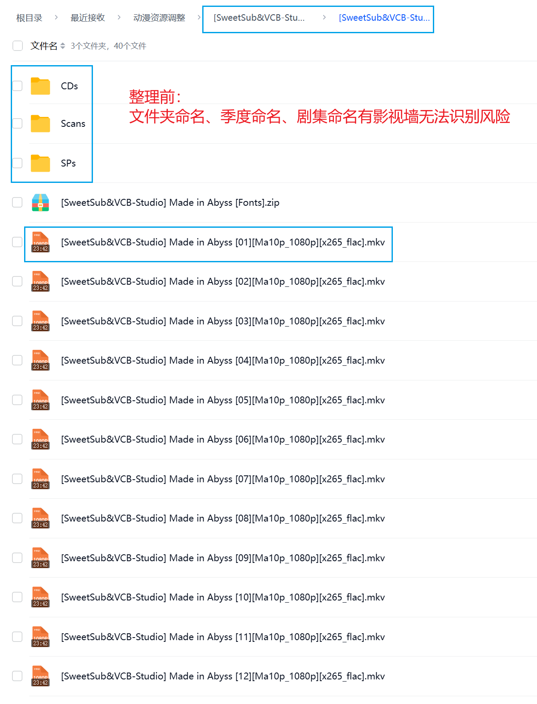
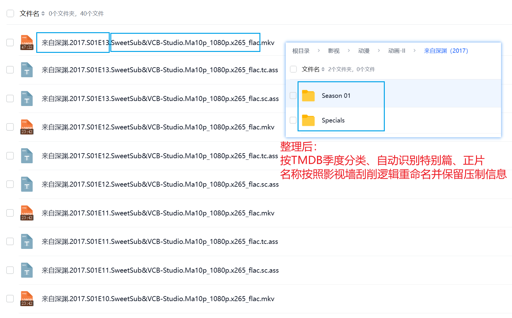
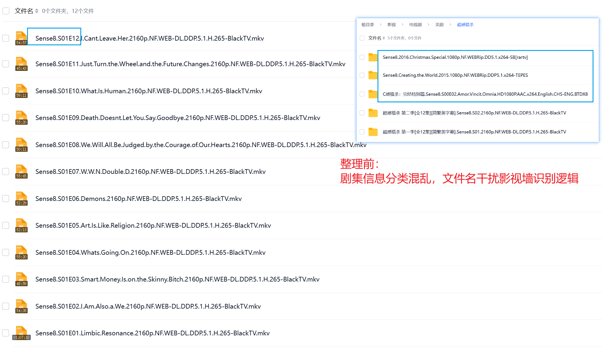
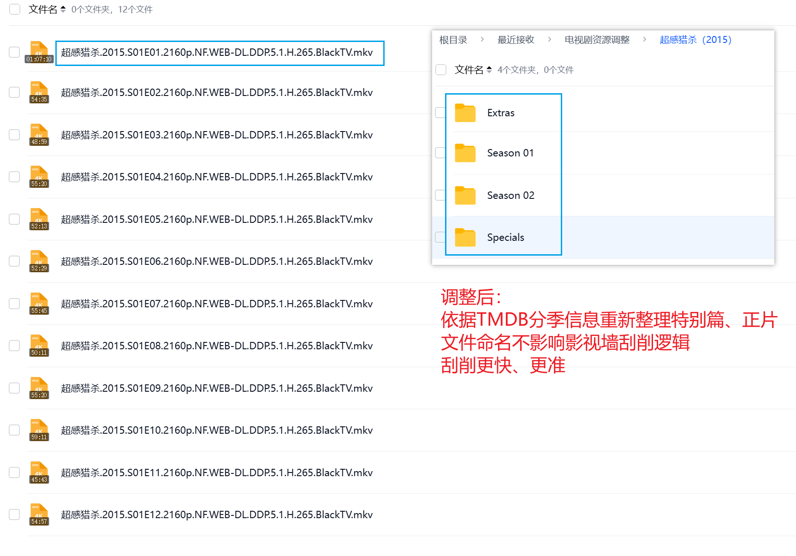
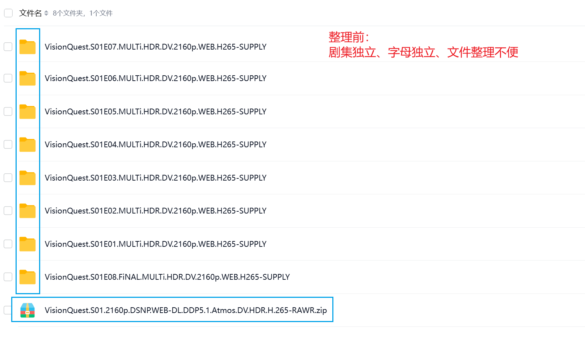
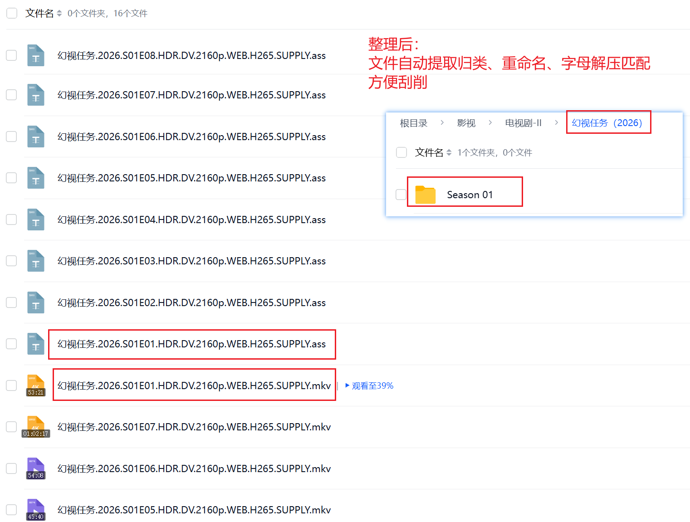
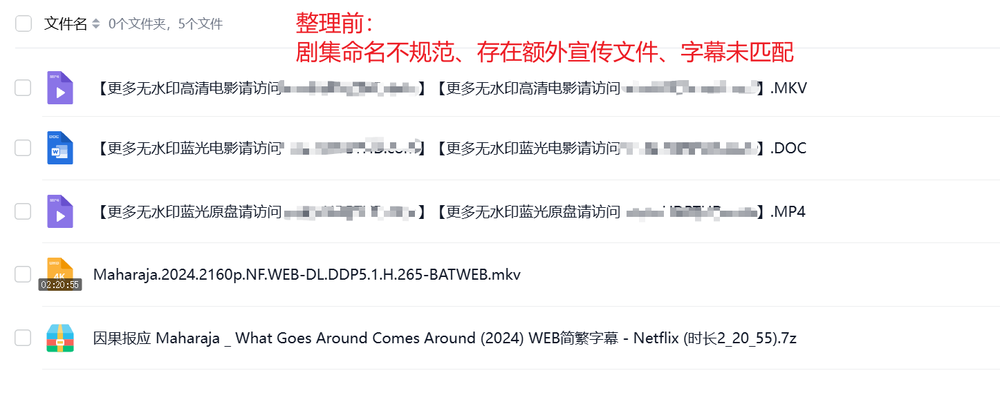

<div align="center">
  <!-- 如需展示项目 Logo，将图片命名为 logo.png 放入 assets/ 并取消下一行注释 -->
  <!-- <p align="center"></p> -->
  <h1 align="center">🎬 Cloud Media Organizer</h1>
  <p align="center">
    <strong>主要面向使用网盘作为影视库的NAS用户，解决网盘重命名不便、影视库识别不准确、网盘资源刮削整理费时费力等问题</strong><br />
  </p>
  <p align="center">
    <a href="#quickstart">快速开始</a> ·
    <a href="#preview">整理效果</a> ·
    <a href="#features">核心功能</a> ·
    <a href="./skills/115-media-organizer/SKILL.md">使用文档</a> ·
    <a href="#faq">常见问题</a> ·
    <a href="#sponsor">赞赏支持</a>
  </p>
  <p align="center">
    <strong>简体中文</strong>
  </p>
  <p align="center">
    <a href="./LICENSE"></a>
    = 22" />
    
    
    <a href="https://github.com/AlonsoGu/cloud-media-organizer/stargazers"></a>
  </p>
</div>


---

<a id="pain-points"></a>
## 💡 说在前面：

硬盘价格一直居高不下，有大部分NAS佬（包括我）已经转向使用网盘作为影视库资源存储的主力。本地资源的刮削工具生态已比较齐全，但网盘资源的整理一直比较头疼，所以才有了这个skill。其实核心功能就一项：以TMDB源影视信息为基准，修改网盘资源名称。

1. **本skill适用范围**：115 网盘 | 百度网盘 | 夸克网盘。
2. **本skill适用人群**：使用网盘较多的NAS用户（飞牛、绿联、极空间等等）、使用纯网盘做影视库且有影视墙需求的用户。
3. **本skill核心功能**：自动识别TMDB信息并以此归类、重命名资源，自动解压字幕文件进行名称匹配、自动清除整理后不必要的文件 。
4. **本skill不会收集任何隐私信息，所有的操作都在本地完成。注意：修改待用户确认后才会执行。**

---

<a id="preview"></a>

## ✨ 整理效果对比（Before / After）

以【无头骑士异闻录】番剧为例，属于“多篇章拆分 + 嵌套外挂字幕压缩包 + 推广垃圾混杂”的典型网盘目录案例：

```text
整理前（刮削报错 / 剧集拆散 / 字幕不挂载）：
无头骑士异闻录/
├── 无头骑士异闻录（第一季）/ [1-24].mkv
├── 无头骑士异闻录×2 承/ [01-12].mkv
├── 无头骑士异闻录×2 转/ [01-12].mkv
├── 无头骑士异闻录×2 结/ [01-12].mkv + SP01_新婚旅行.mkv
├── 外挂字幕合集.zip (内含 第二季/简体/ASS/...)
└── 最新网址扫码关注.png + promo_5MB.mp4

整理后：
无头骑士异闻录（2010）/
├── Season 01/
│   ├── 无头骑士异闻录.2010.S01E01.BDrip.1080p.mkv
│   └── 无头骑士异闻录.2010.S01E01.BDrip.1080p.ass   <-- 自动拆包提取并同名对齐
├── Season 02/
│   ├── 无头骑士异闻录.2010.S02E01.BDrip.1080p.mkv   <-- 承/转/结合并并自动偏移 E01~E36
│   └── ...
└── Specials/
    └── 无头骑士异闻录.2010.S00E05.BDrip.1080p.mkv   <-- 依 TMDB 简介语义精准命中 S00E05
```

### 🖼️ 【刮削实例对比】

#### 🎞️ 实例 1：动漫番剧重构（分季归档 + 特别篇识别 + 简繁字幕对齐）

<table>
  <thead>
    <tr>
      <th width="50%">整理前（Before）</th>
      <th width="50%">整理后（After）</th>
    </tr>
  </thead>
  <tbody>
    <tr>
      <td align="center" valign="top">
        <br />
        <sub>原始压制组目录结构，<code>CDs</code>/<code>Scans</code>/<code>SPs</code> 混杂且缺少标准季集命名，影视墙易识别失败</sub>
      </td>
      <td align="center" valign="top">
        <br />
        <sub>按 TMDB 重构为 <code>Season 01</code> / <code>Specials</code>，保留压制信息并自动匹配 <code>.sc.ass</code> / <code>.tc.ass</code> 双语字幕</sub>
      </td>
    </tr>
  </tbody>
</table>

#### 📺 实例 2：多季美剧整理 （特别篇/幕后区分 + 标准分季命名）

<table>
  <thead>
    <tr>
      <th width="50%">整理前（Before）</th>
      <th width="50%">整理后（After）</th>
    </tr>
  </thead>
  <tbody>
    <tr>
      <td align="center" valign="top">
        <br />
        <sub>正片、圣诞特别篇、完结篇与幕后花絮文件夹混杂，英文冗余命名干扰影视墙刮削</sub>
      </td>
      <td align="center" valign="top">
        <br />
        <sub>依 TMDB 自动归入 <code>Season 01</code> / <code>Season 02</code> / <code>Specials</code> / <code>Extras</code>，规范命名为 <code>片名.年份.SxxExx</code></sub>
      </td>
    </tr>
  </tbody>
</table>

#### 📦 实例 3：散装单集与字幕包 （单集抽提合并 + 字幕拆包匹配）

<table>
  <thead>
    <tr>
      <th width="50%">整理前（Before）</th>
      <th width="50%">整理后（After）</th>
    </tr>
  </thead>
  <tbody>
    <tr>
      <td align="center" valign="top">
        <br />
        <sub>每集各自套一层独立文件夹，外挂字幕打包在 <code>.zip</code> 压缩包内，手动整理繁琐</sub>
      </td>
      <td align="center" valign="top">
        <br />
        <sub>自动合并单集至 <code>Season 01</code> 并清理空目录，同步解压 <code>.ass</code> 字幕与正片同名对齐</sub>
      </td>
    </tr>
  </tbody>
</table>

#### 🧹 实例 4：电影去广告与字幕对齐 （宣传文件清理 + 压缩包字幕提取）

<table>
  <thead>
    <tr>
      <th width="50%">整理前（Before）</th>
      <th width="50%">整理后（After）</th>
    </tr>
  </thead>
  <tbody>
    <tr>
      <td align="center" valign="top">
        <br />
        <sub>混有大量网站宣传引导视频/文档（<code>.MKV</code>/<code>.DOC</code>/<code>.MP4</code>），字幕在 <code>.7z</code> 压缩包中</sub>
      </td>
      <td align="center" valign="top">
        <br />
        <sub>自动清理宣传垃圾文件（移入回收站），电影标准命名并匹配 <code>.sc.ass</code> / <code>.tc.ass</code> 字幕</sub>
      </td>
    </tr>
  </tbody>
</table>


---

<a id="features"></a>

## ⚡ 核心功能

| 功能模块 | 115 网盘 | 百度网盘 | 夸克网盘 | 说明 |
| :--- | :---: | :---: | :---: | :--- |
| 自动弹窗登录并探测当前打开目录 | ✅ | ✅ | ✅ | 自动弹窗，用户扫码登陆后可自动识别网盘标签页与路径/ID |
| TMDB 剧集重分季 & 集号折算 | ✅ | ✅ | ✅ | 完全依据TMDB进行季度、集数信息整理，解决识别不准问题 |
| Season 0 特别篇支持 | ✅ | ✅ | ✅ | 结合 TMDB 单集标题 + 简介识别特别篇信息 |
| 目录重命名 | ✅ | ✅ | ✅ | `片名（年份）`，如【教父（1972）】 |
| 电影标准化命名 | ✅ | ✅ | ✅ | `{片名}.{年份}.{压制信息}`，如效果对比图中 |
| 外挂字幕提取与对齐 | ✅ | ✅ | ✅ | 单字幕同名，多字幕保留 `.sc`/`.tc` 等语言标签 |
| 字幕压缩包云端预检 & 双层云解压 | ✅ | — | — | 百度/夸克自动友好跳过压缩包，不中断主流程（可再次匹配） |
| 垃圾广告清理 & 空目录清理 | ✅ | ✅ | ✅ | 全部移入回收站，保护 `.nfo`/海报/`Fonts.zip` |
| 本地快照与 `--rollback` 一键回滚 | ✅ | ✅ | ✅ | 每次写入前落盘，支持无损还原原目录与文件名 |

---

<a id="quickstart"></a>
## 🚀 快速开始

### ⚙️ 环境要求

- **Node.js >= 22.0.0**
- **Google Chrome**

### 📥 安装方式

#### ⚡ 方式 1：使用 Skills CLI 一键安装（推荐）

```bash
npx skills add AlonsoGu/cloud-media-organizer
```

#### 📂 方式 2：手动克隆至 AI 助手全局 Skill 目录

```bash
git clone https://github.com/AlonsoGu/cloud-media-organizer.git
```

将仓库中的 `skills/115-media-organizer` 文件夹复制到对应工具的全局 Skills 目录：
- **Antigravity**：`~/.gemini/config/skills/115-media-organizer`（Windows 为 `%USERPROFILE%\.gemini\config\skills\115-media-organizer`）
- **Claude Code**：`~/.claude/skills/115-media-organizer`
- **通用 Agent Skills**：`~/.agents/skills/115-media-organizer`

#### 🤖 方式 3：直接让 AI 助手安装

直接把本仓库地址发给你的 AI 助手：
> “请帮我读取并安装这个 GitHub 仓库里的 Skill：`https://github.com/AlonsoGu/cloud-media-organizer`”

### 🎯 使用示例

#### 🗣️ 1. 对 AI 助手直接说自然语言（推荐）

- **整理剧集**：  
  `帮我整理 115 网盘 "根目录/云下载/无头骑士异闻录" 这个目录下的资源。`
- **只对齐外挂字幕（不改视频名）**：  
  `帮我扫描夸克网盘当前打开的电影目录，把压缩包里的字幕提取出来并和视频同名对齐，先预览。`
- **整理电影并规范文件夹名**：  
  `帮我整理百度网盘 "/影视/流浪地球2" 目录。`

#### 💻 2. 命令行直接调用参考

```powershell
# 1. 剧集分季预览 (Dry-Run)
node skills/115-media-organizer/scripts/organizer.mjs `
  --drive 115 `
  --tmdb-query "无头骑士异闻录" `
  --path "根目录/云下载/无头骑士异闻录"

# 2. 确认无误后正式执行 + 清理已腾空旧目录
node skills/115-media-organizer/scripts/organizer.mjs `
  --drive 115 `
  --execute `
  --clean-empty-dirs `
  --tmdb-url "https://www.themoviedb.org/tv/31798/seasons" `
  --cid "<预览确认的目录ID或路径>"

# 3. 独立外挂字幕拆包与对齐 (--match-subs)
node skills/115-media-organizer/scripts/organizer.mjs `
  --drive auto `
  --match-subs `
  --path "<目标网盘目录>"

# 4. 运行内置单元测试
cd skills/115-media-organizer/scripts
npm test
```

更多 CLI 参数（`--sp-map`、`--trust-sp-num`、`--clean-ads`、`--rollback`、`--clean-snapshots` 等）详见 [SKILL.md](./skills/115-media-organizer/SKILL.md)。

---

<a id="faq"></a>
## ❓ 常见问题

- **Q：百度网盘和夸克网盘支持在线解压字幕压缩包吗？**  
  A：目前自动云解压仅支持 **115 网盘**；百度网盘和夸克网盘可自动穿透多层已解压文件夹提取与对齐外挂字幕，遇压缩包会友好提示跳过，不中断整理流程，但可以二次对话进行解压缩匹配。
- **Q：改名或移动错了怎么办？**  
  A：默认不传 `--execute` 时不会写入任何修改；正式执行前会自动生成回滚快照到系统本地缓存目录，可通过 `--rollback "<快照json路径>"` 一键还原目录与文件名。
- **Q：在共用电脑使用完，如何清理本地登录态与快照？**  
  A：运行 `node skills/115-media-organizer/scripts/organizer.mjs --clean-snapshots` 可清空全部历史快照；如需清理登录态，关闭弹出的调试 Chrome 并删除 `%LOCALAPPDATA%\cloud-media-organizer\chrome-profile`（macOS/Linux 为 `~/.cache/cloud-media-organizer/chrome-profile`）即可。

---

<a id="sponsor"></a>
## ☕ 赞赏与支持

本项目核心代码完全开源免费，不设任何付费功能或加密限制。  
如果这个 Skill 帮你省下了大量手动重命名、对字幕和修复 NAS 刮削的时间，欢迎请作者喝杯咖啡 ☕，你的支持是我持续适配更多网盘和刮削规则的最大动力！

<div align="center">
<table align="center">
  <tr>
    <td align="center">
      <br />
      <sub>微信赞赏</sub>
    </td>
    <td align="center">
      <br />
      <sub>支付宝赞赏</sub>
    </td>
  </tr>
</table>
</div>


---

## ⚠️ 免责声明

- 本工具仅用于在用户个人合法持有的网盘账户内整理自有媒体文件命名与目录结构，**不提供任何资源下载、解析或绕过网盘会员限制的功能**。
- 批量文件操作前请务必仔细核对 Dry-Run 预览输出；建议妥善保留变更后的本地回滚快照。

## 📄 License

[MIT](./LICENSE)
